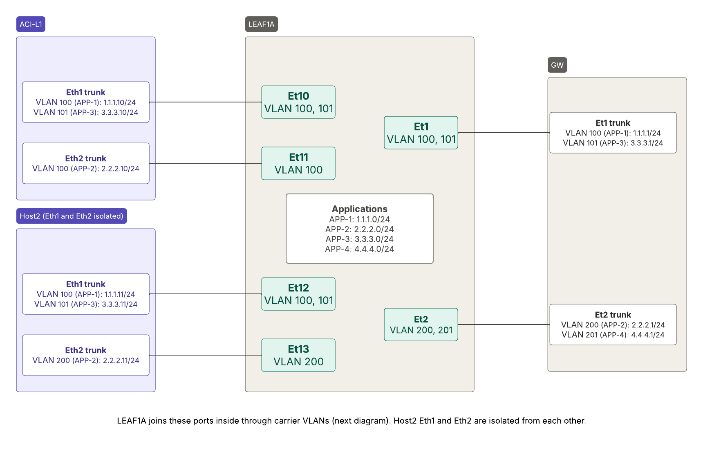
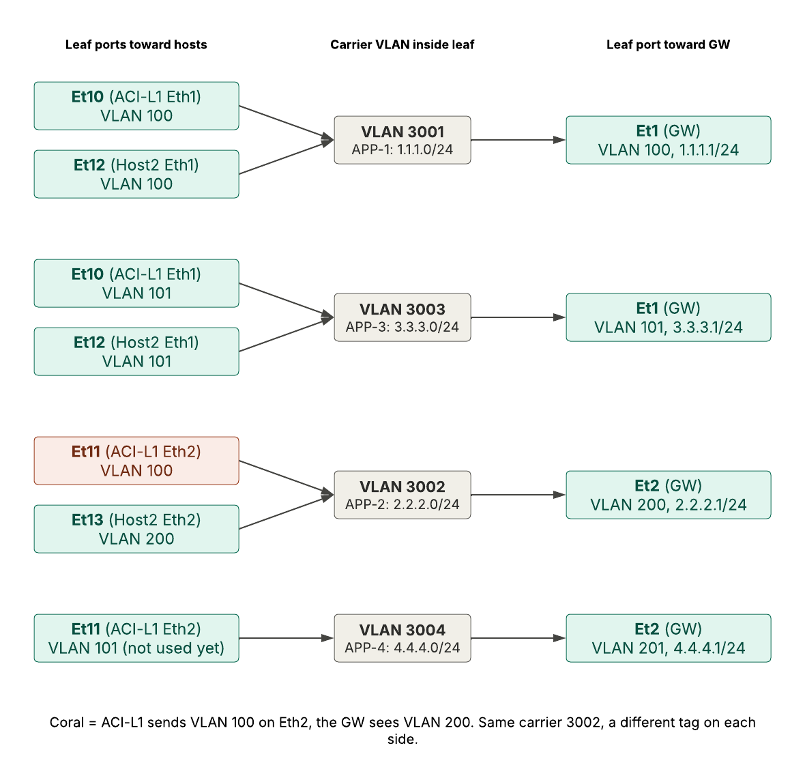

# ACI example: two hosts, one leaf, one gateway

This lab uses two `pvlan-sw` containers as ACI style endpoints. Both hosts connect to one Arista cEOS leaf (`LEAF1A`), and the leaf connects to a gateway (`GW`). It shows three things:

- a host port that carries **several VLANs** (a trunk), each VLAN with its own IP,
- a host whose two ports are **isolated** from each other, and
- a leaf that moves the traffic **without ever creating the customer VLANs** (100, 101, 200, 201) in its own VLAN database, and
- **the same VLAN number used by different applications**, like Cisco ACI does when two apps share a VLAN ID on different ports.

For the full command list and troubleshooting, see [README.md](README.md).

## Contents

1. [Topology](#topology)
2. [Host configuration](#host-configuration)
3. [How the leaf joins the ports](#how-the-leaf-joins-the-ports)
4. [Gateway configuration](#gateway-configuration)
5. [Test it](#test-it)
6. [Things to know](#things-to-know)

## Topology



In the diagram every host port is shown as a physical interface with the VLANs it carries. The Linux bridge that `pvlan-sw` uses internally is not drawn, so you only see ports, VLANs and IPs.

| Device | Port | VLANs | IP addresses (application) |
| --- | --- | --- | --- |
| ACI-L1 | Eth1 (trunk) | 100, 101 | 1.1.1.10/24 on VLAN 100 (APP-1), 3.3.3.10/24 on VLAN 101 (APP-3) |
| ACI-L1 | Eth2 (trunk) | 100 | 2.2.2.10/24 on VLAN 100 (APP-2) |
| Host2 | Eth1 (trunk) | 100, 101 | 1.1.1.11/24 on VLAN 100 (APP-1), 3.3.3.11/24 on VLAN 101 (APP-3) |
| Host2 | Eth2 (trunk) | 200 | 2.2.2.11/24 on VLAN 200 (APP-2) |
| GW | Et1 (trunk) | 100, 101 | 1.1.1.1/24 on VLAN 100 (APP-1), 3.3.3.1/24 on VLAN 101 (APP-3) |
| GW | Et2 (trunk) | 200, 201 | 2.2.2.1/24 on VLAN 200 (APP-2), 4.4.4.1/24 on VLAN 201 (APP-4) |

ACI-L1 sends VLAN 100 on **both** of its ports, but they carry different applications (APP-1 and APP-2) and end up in different gateway VLANs (100 and 200). That is the ACI style part: the VLAN number on the host does not have to match the VLAN number on the gateway.

### Applications and subnets

Each application owns one subnet. The VLAN number is only a tag on a port. The subnet tells you which application the traffic belongs to.

| Application | Subnet | GW VLAN | Carrier VLAN | Where it appears |
| --- | --- | --- | --- | --- |
| APP-1 | 1.1.1.0/24 | 100 | 3001 | ACI-L1 Eth1 VLAN 100, Host2 Eth1 VLAN 100 |
| APP-2 | 2.2.2.0/24 | 200 | 3002 | ACI-L1 Eth2 VLAN 100, Host2 Eth2 VLAN 200 |
| APP-3 | 3.3.3.0/24 | 101 | 3003 | ACI-L1 Eth1 VLAN 101, Host2 Eth1 VLAN 101 |
| APP-4 | 4.4.4.0/24 | 201 | 3004 | ACI-L1 Eth2 VLAN 101 (not used yet) |

**APP-1 and APP-2 both use VLAN 100 on ACI-L1.** They are told apart by the port: Eth1 carries APP-1 and Eth2 carries APP-2. On the gateway they become VLAN 100 and VLAN 200. This is the ACI behavior the lab reproduces: one VLAN ID, several applications, and the fabric (here the leaf) keeps them apart.

### Topology file

```yaml
management_network: a-135
subnet_pool: 172.16.0.0/16

linux_nodes:
  ACI-L1:
    image: pvlan-sw:latest
  Host2:
    image: pvlan-sw:latest

connections:
  - { device1: ACI-L1, intf1: Ethernet1, device2: LEAF1A, intf2: Ethernet10 }
  - { device1: ACI-L1, intf1: Ethernet2, device2: LEAF1A, intf2: Ethernet11 }
  - { device1: Host2, intf1: Ethernet1, device2: LEAF1A, intf2: Ethernet12 }
  - { device1: Host2, intf1: Ethernet2, device2: LEAF1A, intf2: Ethernet13 }
  - { device1: LEAF1A, intf1: Ethernet1, device2: GW, intf2: Ethernet1 }
  - { device1: LEAF1A, intf1: Ethernet2, device2: GW, intf2: Ethernet2 }
```

Generate and start it:

```sh
python3 generate-lab.py topology-pvlan.yml
python3 start-lab.py
```

## Host configuration

Nothing is configured at boot. Once the lab is running, run the `pvlan` commands below on each host.

### ACI-L1: one IP per port and VLAN (L3 mode)

Each port keeps its own IP per VLAN. Nothing is shared between the ports.

```sh
pvlan l3 Ethernet1 100 1.1.1.10/24
pvlan l3 Ethernet1 101 3.3.3.10/24
pvlan l3 Ethernet2 100 2.2.2.10/24
pvlan show
```

Result:

```
IP interfaces:
eth1.100@eth1    UP             1.1.1.10/24
eth1.101@eth1    UP             3.3.3.10/24
eth2.100@eth2    UP             2.2.2.10/24
```

On the wire, Eth1 sends VLAN 100 and VLAN 101 tagged, and Eth2 sends VLAN 100 tagged.

### Host2: trunk ports with isolation (bridge mode)

Eth1 carries VLANs 100 and 101, Eth2 carries VLAN 200, the two ports are isolated from each other, and the host has an address in each VLAN.

```sh
pvlan vlan add 100 Ethernet1 --tagged
pvlan vlan add 101 Ethernet1 --tagged
pvlan vlan add 200 Ethernet2 --tagged
pvlan isolate Ethernet1 Ethernet2
pvlan ip 100 1.1.1.11/24
pvlan ip 101 3.3.3.11/24
pvlan ip 200 2.2.2.11/24
pvlan show
```

Result:

```
port              vlan-id
eth1              100
                  101
eth2              200
br0               100
                  101
                  200

IP interfaces:
br0.100@br0      UP             1.1.1.11/24
br0.200@br0      UP             2.2.2.11/24
br0.101@br0      UP             3.3.3.11/24

port isolation:
eth1 isolated on
eth2 isolated on
```

The `br0` lines are the host's internal bridge. In the diagrams the addresses are drawn on the physical port and VLAN they belong to, because that is where the traffic actually leaves the host.

## How the leaf joins the ports

The leaf does not create VLAN 100, 101, 200 or 201. It uses **carrier VLANs** (3001 to 3004) as private meeting points inside the leaf. Every port that belongs together is attached to the same carrier VLAN, and the carrier hides the customer VLAN numbers.



| Carrier VLAN | Application | Host side | GW side | What it connects |
| --- | --- | --- | --- | --- |
| 3001 | APP-1 | Et10 VLAN 100 (ACI-L1 Eth1), Et12 VLAN 100 (Host2 Eth1) | Et1 VLAN 100 | 1.1.1.0/24 |
| 3003 | APP-3 | Et10 VLAN 101 (ACI-L1 Eth1), Et12 VLAN 101 (Host2 Eth1) | Et1 VLAN 101 | 3.3.3.0/24 |
| 3002 | APP-2 | Et11 VLAN 100 (ACI-L1 Eth2), Et13 VLAN 200 (Host2 Eth2) | Et2 VLAN 200 | 2.2.2.0/24. ACI-L1 sends VLAN 100, the GW sees VLAN 200. |
| 3004 | APP-4 | Et11 VLAN 101 (ACI-L1 Eth2, not used yet) | Et2 VLAN 201 | 4.4.4.0/24 |

The leaf uses two techniques.

**Layer 2 subinterfaces** (ports facing ACI-L1 and the GW). The parent port is a routed port (`no switchport`), and each subinterface matches one VLAN tag and drops the frame into a carrier VLAN.

**VLAN translation** (ports facing Host2). The ports stay normal trunk ports, and a translation line maps the VLAN the host sends to a carrier VLAN.

### LEAF1A configuration (relevant parts)

```
vlan 3001-3004

! ACI-L1 Eth1, carries VLAN 100 and 101
interface Ethernet10
   no switchport
interface Ethernet10.100
   vlan id 3001
   encapsulation vlan
      client dot1q 100 network client
interface Ethernet10.101
   encapsulation dot1q vlan 101
   vlan id 3003

! ACI-L1 Eth2, carries VLAN 100 (VLAN 101 prepared)
interface Ethernet11
   no switchport
interface Ethernet11.100
   encapsulation dot1q vlan 100
   vlan id 3002
interface Ethernet11.101
   encapsulation dot1q vlan 101
   vlan id 3004

! Host2 Eth1 (VLAN 100, 101) and Eth2 (VLAN 200), plain trunks with translation to the carrier VLANs
interface Ethernet12
   switchport mode trunk
   switchport vlan translation 100 3001
   switchport vlan translation 101 3003
   spanning-tree portfast edge
   spanning-tree guard root
interface Ethernet13
   switchport mode trunk
   switchport vlan translation 200 3002
   spanning-tree portfast edge
   spanning-tree guard root

! Toward the GW
interface Ethernet1
   no switchport
interface Ethernet1.100
   vlan id 3001
   encapsulation vlan
      client dot1q 100 network client
interface Ethernet1.101
   encapsulation dot1q vlan 101
   vlan id 3003
interface Ethernet2
   no switchport
interface Ethernet2.200
   encapsulation dot1q vlan 200
   vlan id 3002
interface Ethernet2.201
   encapsulation dot1q vlan 201
   vlan id 3004

no ip routing
```

The rewrite from VLAN 100 to VLAN 200 on ACI-L1 Eth2 happens because `Ethernet11.100` and `Ethernet2.200` share carrier 3002 but use different dot1q tags. Each extra VLAN needs one more pair of subinterfaces and one more carrier VLAN.

## Gateway configuration

The gateway sees ordinary VLANs on two trunks. It does not know that a carrier VLAN or a VLAN rewrite exists.

```
vlan 100-101,200-201

interface Ethernet1
   switchport trunk allowed vlan 100-101
   switchport mode trunk
interface Ethernet2
   switchport trunk allowed vlan 200-201
   switchport mode trunk

interface Vlan100
   ip address 1.1.1.1/24
interface Vlan101
   ip address 3.3.3.1/24
interface Vlan200
   ip address 2.2.2.1/24
interface Vlan201
   ip address 4.4.4.1/24

no ip routing
```

`no ip routing` means the gateway only answers on its own addresses and does not route between the subnets. That is enough for this test.

## Test it

Always use `-I <interface>` so the ping leaves through the interface you mean. Several lab addresses (for example 1.1.1.1) are also public addresses, and without `-I` a ping can silently go out through the management port.

**ACI-L1:**

```sh
ping -c 3 -I eth1.100 1.1.1.1
ping -c 3 -I eth1.101 3.3.3.1
ping -c 3 -I eth2.100 2.2.2.1
```

**Host2:**

```sh
ping -c 3 -I br0.100 1.1.1.1
ping -c 3 -I br0.101 3.3.3.1
ping -c 3 -I br0.200 2.2.2.1
```

**Between the hosts** (they share carrier VLANs 3001, 3003 and 3002 on the leaf):

```sh
# on ACI-L1
ping -c 3 -I eth1.100 1.1.1.11
ping -c 3 -I eth1.101 3.3.3.11
ping -c 3 -I eth2.100 2.2.2.11
```

**See the tags on the wire** (run on a host while pinging):

```sh
tcpdump -eni eth1 arp or icmp
```

**On the leaf**, each carrier VLAN should list the ports and MAC addresses that belong to it:

```
show mac address-table vlan 3001
show mac address-table vlan 3002
show mac address-table vlan 3003
```

## Things to know

- **Isolation only applies inside Host2.** It stops Host2 Eth1 and Host2 Eth2 from reaching each other through the host. It does not stop Host2 from reaching ACI-L1 or the GW, because the leaf puts them in the same carrier VLANs (3001, 3002 and 3003).
- **VLAN 101 is shared on purpose.** ACI-L1 Eth1 and Host2 Eth1 both send VLAN 101 into carrier 3003, so 3.3.3.10 and 3.3.3.11 sit in the same network as the GW address 3.3.3.1.
- **Host settings are not saved.** Rebuilding or recreating a host container loses everything set with `pvlan`. Keep the commands from this page handy.
- **Save the switch configs** with `write memory` on LEAF1A and GW if you want them to survive a restart.
