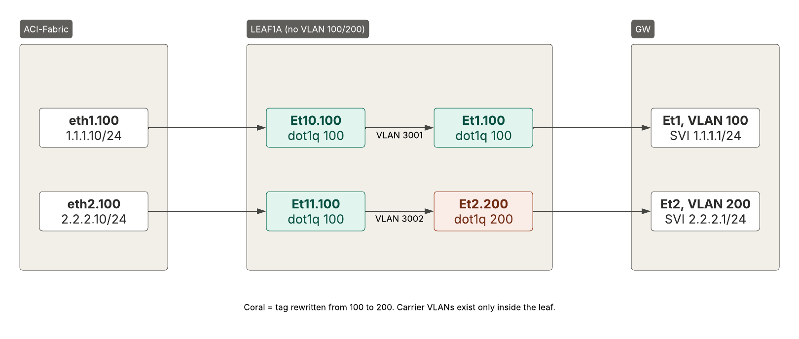

# pvlan-sw

A tiny Linux container (Alpine, about 10 MB) that behaves like a Cisco ACI style endpoint switch inside a cEOS docker-compose lab.

What it gives you:

- Ports that sit in the **same VLAN but cannot talk to each other** (port isolation, like ACI intra-EPG isolation).
- **Per-port IPs on different subnets**, all in the same VLAN (for example `eth1.100 = 1.1.1.10/24`, `eth2.100 = 2.2.2.10/24`).
- **Trunk ports** (tagged VLANs) and an IP on the switch itself, like an SVI.
- Everything is configured **at runtime** with one command, `pvlan`. VLAN numbers are arguments, nothing is hard coded.



*Path 1 carries VLAN 100 unchanged through carrier VLAN 3001. Path 2 enters as VLAN 100 and leaves as VLAN 200 through carrier VLAN 3002 (coral box). Carrier VLANs exist only inside the leaf.*

A larger example with two hosts, a trunk, isolation, one leaf and a gateway is in [ACI-example.md](ACI-example.md).

## Contents

1. [Files](#files)
2. [Build the image](#build-the-image)
3. [Add it to a lab](#add-it-to-a-lab)
4. [Command reference](#command-reference)
5. [Two modes: bridge mode and L3 mode](#two-modes-bridge-mode-and-l3-mode)
6. [Examples](#examples)
7. [Matching switch config (Arista cEOS)](#matching-switch-config-arista-ceos)
8. [Troubleshooting](#troubleshooting)
9. [Good to know](#good-to-know)

## Files

| File | Purpose |
| --- | --- |
| `Dockerfile` | Alpine image with `iproute2`, `bridge-utils` and `tcpdump` |
| `entrypoint.sh` | Runs when the container starts: creates the VLAN-aware bridge `br0` and attaches the data ports |
| `images/` | Diagrams used in this README |
| `shellrc` | Shell prompt and colors: the hostname in green as the prompt, and colored `ls`, `grep`, `ip` and `bridge` |
| `pvlan` | The command you use inside the container (installed as `/root/pvlan` and `/usr/local/bin/pvlan`) |

## Build the image

Run this on the Docker host, inside the `pvlan-sw` folder (the folder that contains the `Dockerfile`):

```sh
cd pvlan-sw
docker build --no-cache -t pvlan-sw:latest .
```

The container must run `privileged` because it creates a bridge and VLAN interfaces. The lab generator already sets that.

## Add it to a lab

Add a `linux_nodes` section to the topology file, then connect the node like any other device. Interface names are only labels: the first connection becomes `eth1`, the second `eth2`, and so on. `eth0` is the management port.

```yaml
management_network: a-135
subnet_pool: 172.16.0.0/16

linux_nodes:
  PVLAN-SW:
    image: pvlan-sw:latest     # optional, this is the default
    # isolated: [Ethernet1, Ethernet2]   # optional, start these ports isolated
    # vlan: 100                          # optional, pre-create VLAN 100 (untagged) on all ports

connections:
  - { device1: PVLAN-SW, intf1: Ethernet1, device2: LEAF1A, intf2: Ethernet10 }
  - { device1: PVLAN-SW, intf1: Ethernet2, device2: LEAF1A, intf2: Ethernet11 }
```

Generate and start the lab, then open a shell in the node:

```sh
python3 generate-lab.py topology-pvlan.yml
docker-compose up -d
docker exec -it PVLAN-SW sh
```

The container runs `entrypoint.sh` by itself every time it starts. You never run it by hand.

## Command reference

Ports can be written as `ethN` or as the labels from the topology file (`Ethernet1`, ...).

| Command | What it does |
| --- | --- |
| `pvlan setup <vid> [ports] [--isolate ports] [--tagged] [--ad]` | One shot. Puts the ports in VLAN `<vid>` (all data ports if none given) and isolates the ones listed after `--isolate`. `--tagged` makes them trunk ports. `--ad` uses 802.1ad (0x88a8) for the outer tag. |
| `pvlan vlan add <vid> <ports> [--tagged]` | Add a VLAN to ports. Untagged (access) by default, tagged with `--tagged`. |
| `pvlan vlan del <vid> <ports>` | Remove a VLAN from ports. |
| `pvlan isolate <ports>` | Isolated ports cannot talk to other isolated ports. |
| `pvlan open <ports>` | Clear isolation on ports. |
| `pvlan l3 <port> <vid> <addr/len> [--vrf <name>] [--gw <ip>]` | Give one port its own IP in VLAN `<vid>`, as the subinterface `ethN.<vid>`. `--vrf` puts it in a VRF, `--gw` adds a default gateway (both optional). |
| `pvlan l3 del <port> <vid>` | Remove that port IP interface. |
| `pvlan ip <vid> <addr/len> [--vrf <name>] [--gw <ip>]` | Add an IP to the switch itself in VLAN `<vid>` (like an SVI, interface `br0.<vid>`). Run again with another subnet to add more addresses. `--vrf` and `--gw` work as for `l3`. |
| `pvlan ip del <vid> [addr/len]` | Remove one address, or the whole IP interface if no address is given. |
| `pvlan vrf add <name>` | Create a VRF, a separate routing table. |
| `pvlan vrf del <name>` | Delete a VRF. Its interfaces go back to the default table. |
| `pvlan vrf attach <name> <iface>...` | Move interfaces such as `eth1.100` or `br0.100` into a VRF. Their IPs are kept. |
| `pvlan vrf detach <iface>...` | Move interfaces back to the default table. |
| `pvlan vrf show` | List the VRFs, their interfaces and default routes. |
| `pvlan gw <vrf> <ip>` | Set an optional default gateway for a VRF. |
| `pvlan gw del <vrf>` | Remove it again. |
| `pvlan show` | Show VLAN membership, IP interfaces, VRFs and isolation state. |

## Two modes: bridge mode and L3 mode

A Linux port cannot be a bridge member and also hold its own IP, so there are two ways to use a port. Pick one per port.

| | Bridge mode | L3 mode |
| --- | --- | --- |
| Commands | `setup`, `vlan add`, `isolate`, `ip` | `l3` |
| Port is in `br0` | Yes | No |
| Where the IP lives | On the switch (`br0.<vid>`) | On the port (`ethN.<vid>`) |
| L2 shared with other ports | Yes, unless the ports are isolated | None |
| Use it for | Trunks, access ports, isolation tests | ACI style endpoints, one IP and one gateway per port |

Moving a port from L3 mode to bridge mode is automatic: `setup` and `vlan add` attach the port to `br0` for you. Remove old `l3` interfaces first with `pvlan l3 del`.

## Examples

### 1. ACI style endpoints: two ports, one VLAN, different subnets

Each port has its own IP in VLAN 100 and its own gateway. There is no L2 between the ports.

```sh
pvlan l3 Ethernet1 100 1.1.1.10/24
pvlan l3 Ethernet2 100 2.2.2.10/24
pvlan show

ping -c 3 -I eth1.100 1.1.1.1
ping -c 3 -I eth2.100 2.2.2.1
```

Remove them again:

```sh
pvlan l3 del Ethernet1 100
pvlan l3 del Ethernet2 100
```

### 2. A trunk port with an IP

Ethernet1 carries VLAN 100 tagged, and the switch itself has an address in that VLAN.

```sh
pvlan setup 100 Ethernet1 --tagged
pvlan ip 100 1.1.1.11/24
pvlan show

ping -c 3 -I br0.100 1.1.1.1
```

Add more VLANs to the same trunk:

```sh
pvlan vlan add 101 Ethernet1 --tagged
pvlan ip 101 3.3.3.11/24
```

### 3. Several VLANs on one physical port, each with its own IP, no bridge

```sh
pvlan l3 Ethernet1 100 1.1.1.10/24
pvlan l3 Ethernet1 101 3.3.3.10/24
```

### 4. Port isolation (intra-EPG style)

Three ports in VLAN 100. Ethernet1 and Ethernet2 are isolated from each other, and both can still reach the open gateway port Ethernet3.

```sh
pvlan setup 100 Ethernet1 Ethernet2 Ethernet3 --isolate Ethernet1 Ethernet2
pvlan show
```

Change isolation later:

```sh
pvlan open Ethernet2        # Ethernet2 can reach everyone again
pvlan isolate Ethernet2     # and isolate it again
```

Isolation is per port in the Linux kernel, not per VLAN.

### 5. Q-in-Q (outer tag on the port, inner tags untouched)

```sh
pvlan setup 100 Ethernet1 Ethernet2 Ethernet3 --isolate Ethernet1 Ethernet2 --tagged
pvlan setup 100 Ethernet1 Ethernet2 Ethernet3 --isolate Ethernet1 Ethernet2 --tagged --ad   # 802.1ad outer tag
```

Q-in-Q adds 4 bytes to every frame. Raise the MTU on the path if large frames are dropped.

### 6. Two subnets in one VLAN on the switch itself

```sh
pvlan ip 100 10.0.100.254/24
pvlan ip 100 10.0.200.254/24
```

### 7. One VRF per application, with an optional gateway each

A VRF is a separate routing table. Two applications can use the same subnet, and each VRF can have its own default gateway. The gateway is optional: leave out `--gw` and the VRF only has its connected subnet.

```sh
pvlan l3 Ethernet1 100 10.0.0.10/24 --vrf APP-1 --gw 10.0.0.1
pvlan l3 Ethernet2 100 10.0.0.10/24 --vrf APP-2 --gw 10.0.0.254
pvlan vrf show
```

```text
VRFs:
APP-1: eth1.100
    default via 10.0.0.1 dev eth1.100
APP-2: eth2.100
    default via 10.0.0.254 dev eth2.100
```

Both ports use 10.0.0.10/24 and nothing clashes, because each lives in its own routing table. Ping from a VRF by naming the VRF or its interface: `ping -I APP-1 10.0.0.1`.

Bridge mode works the same way:

```sh
pvlan ip 200 5.5.5.5/24 --vrf APP-3          # br0.200 goes into VRF APP-3
pvlan gw APP-3 5.5.5.1                       # add the gateway later
pvlan vrf attach APP-3 br0.300               # move another interface in
pvlan gw del APP-3                           # remove the gateway again
```

## Matching switch config (Arista cEOS)

Example for the lab in the diagram above. The leaf never needs VLAN 100 or 200 in its own VLAN database. It uses L2 subinterface pairs that share a **carrier VLAN** (3001, 3002). The tag is rewritten on path 2 because the two subinterfaces in the pair use different dot1q tags.

**Leaf** (`no switchport` parents, `no ip routing`):

```
vlan 3001-3002

interface Ethernet10
   no switchport
interface Ethernet1
   no switchport
interface Ethernet11
   no switchport
interface Ethernet2
   no switchport

! Path 1: VLAN 100 in, VLAN 100 out
interface Ethernet10.100
   encapsulation dot1q vlan 100
   vlan id 3001
interface Ethernet1.100
   encapsulation dot1q vlan 100
   vlan id 3001

! Path 2: VLAN 100 in, VLAN 200 out
interface Ethernet11.100
   encapsulation dot1q vlan 100
   vlan id 3002
interface Ethernet2.200
   encapsulation dot1q vlan 200
   vlan id 3002
```

Each extra VLAN needs one more pair of subinterfaces and one more carrier VLAN.

**Gateway:**

```
vlan 100,200
interface Ethernet1
   switchport mode trunk
   switchport trunk allowed vlan 100
interface Ethernet2
   switchport mode trunk
   switchport trunk allowed vlan 200
interface Vlan100
   ip address 1.1.1.1/24
interface Vlan200
   ip address 2.2.2.1/24
```

Not supported on cEOS in this lab: FlexEncap ranges with `network client` (one subinterface carrying many VLANs). Use one subinterface pair per VLAN instead.

**Verify on the leaf:**

```
show mac address-table
```

The PVLAN-SW MACs should appear on `Et10.100` and `Et11.100`, and the gateway MACs on `Et1.100` and `Et2.200`, in the carrier VLANs only.

## Troubleshooting

| Symptom | Cause and fix |
| --- | --- |
| Ping works but the reply has a TTL around 50 and a few milliseconds | The traffic left through the management port to the real internet. This happens when a lab address such as `1.1.1.1` is also a public address and the VLAN interface is down. Bring the interface up and ping with `-I <interface>`, or use private subnets for the lab. |
| `ip link set br0.100 up` says `Address not available` | The bridge had an all-zero MAC. Current scripts fix this automatically. On an older image: `MAC=$(cat /sys/class/net/eth1/address); ip link set br0 address $MAC; ip link set br0.100 address $MAC; ip link set br0 up; ip link set br0.100 up` |
| `RTNETLINK answers: Not supported` from `setup` | The port was not in the bridge (for example after `l3` mode). Current scripts attach it automatically. On an older image: `ip link set eth1 master br0`, then repeat the command. |
| VLAN interface is up but nothing answers | The bridge itself must be a member of the VLAN: `bridge vlan add dev br0 vid 100 self` (done by `pvlan ip`). Also check that the upstream switch carries the same VLAN. |
| `could not create VRF` | The Docker host kernel has no VRF support. Run `modprobe vrf` on the Docker host and try again. |
| Not sure what leaves the port | `tcpdump -eni eth1 arp or icmp` shows the VLAN tag of every frame. |

## Good to know

- **Nothing is saved.** VLANs, IPs and isolation set with `pvlan` are lost when the container is recreated. Put your `pvlan` commands in a script or in your lab notes.
- **Updating the scripts:** a new container made from an old image runs the old scripts. Rebuild the image, or copy a new `pvlan` into a running container with `docker cp pvlan <container>:/root/pvlan`.
- **Requirements:** a Linux kernel with bridge VLAN filtering and per-port isolation (4.18 or newer), and a privileged container. VRFs also need the `vrf` kernel module on the Docker host.
